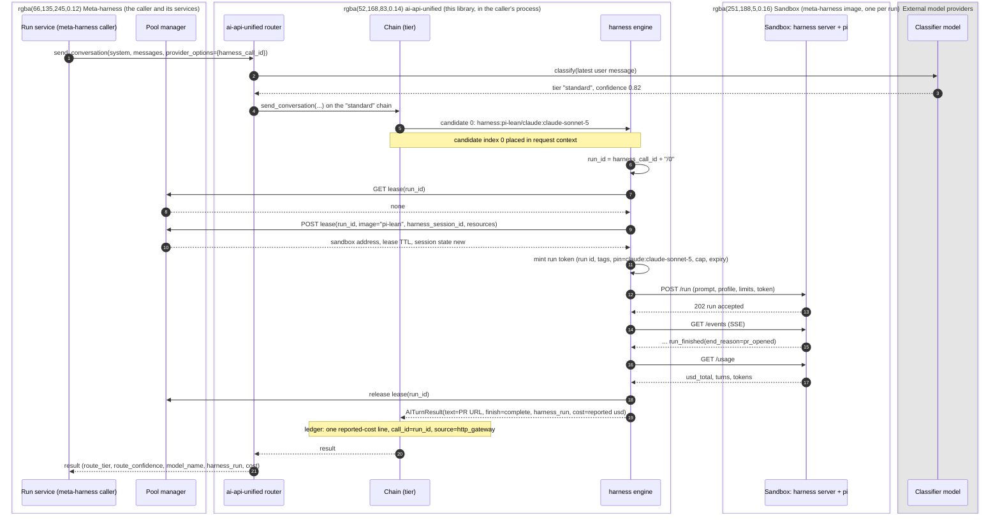
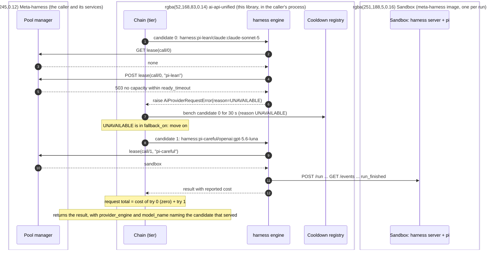
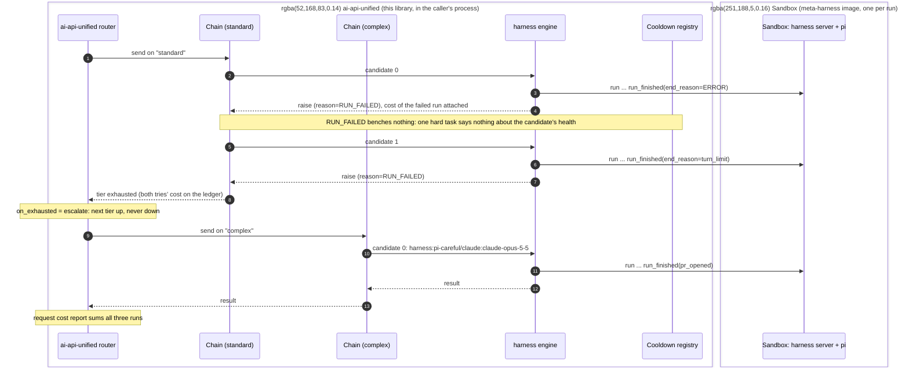
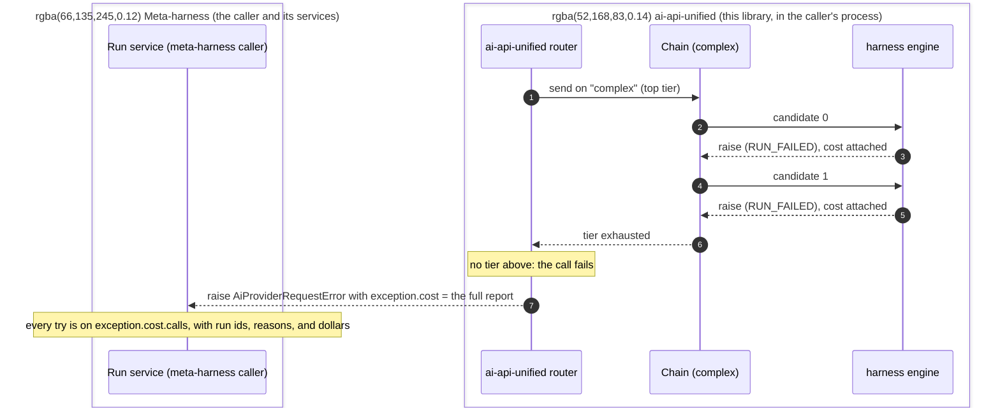
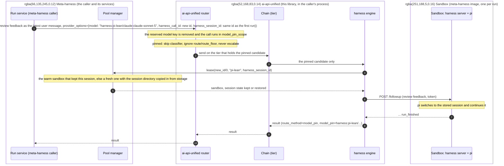
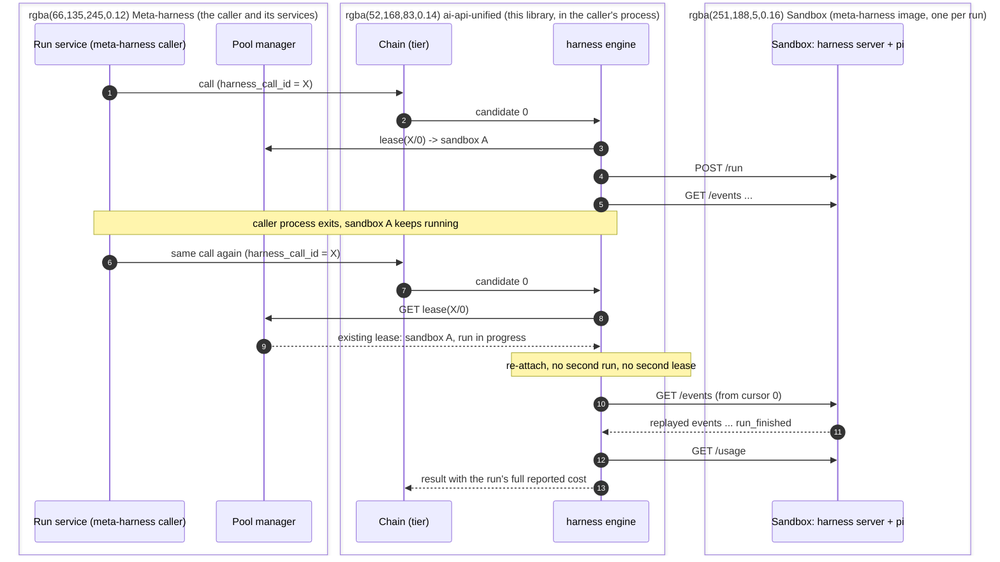
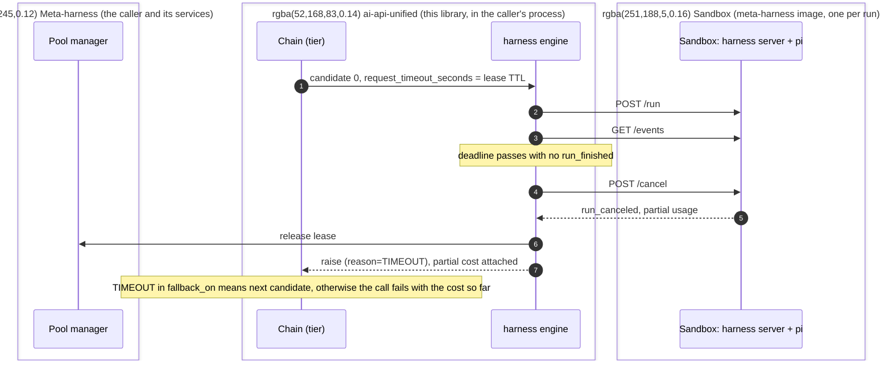
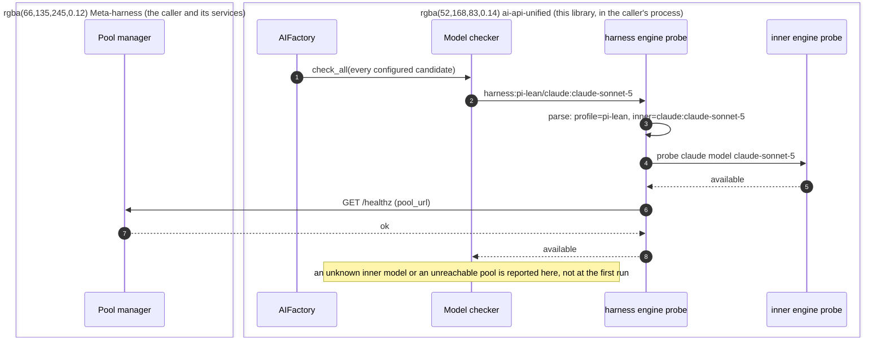

# Harness Engine Design

## Summary

This document describes a `harness` completions engine. It lets a router
tier candidate name a whole coding run instead of a single model call. The
candidate form is `harness:<profile>/<inner-engine>:<inner-model>`, for
example `harness:pi-lean/claude:claude-sonnet-5`.

The engine serves the meta-harness, a control plane that routes
coding tasks to a harness-and-model combination and runs the harness in a
sandbox. The meta-harness is the caller in every diagram below. Its own
design document has the whole-system sequences (task API, scheduler,
HTTP Gateway, console); this document stops at the library's boundary.

## The library's role

1. **A stateless router behind one call.** One call brings everything the
   library needs, apart from `models.json`, which it loads once per process.
   The library runs no server, keeps no store, does no background work, and
   pushes no data.
2. **A harness is an engine.** The router treats a harness candidate like
   any other candidate: the fallback chain, cooldowns, pins, floors, and the
   cost ledger apply unchanged. The library does not know which program runs
   in the sandbox. It uses only a small Run API and a lease API.
3. **The return value is the whole data contract.** Everything the library
   learns about a call is on the result, on success and on failure. The
   caller records what it wants from that. The library's logs and events
   serve operators of the library and are not an interface.
4. **The caller controls each call through `provider_options` only.** `model` (a
   hard-coded harness and model), `route`, `route_floor`, `route_ceiling`,
   `thinking`, `purpose`, `harness_call_id`, and `harness_session_id`. A pin
   ignores route hints
   and never escalates. Any other rule, such as sending a pinned run's
   compaction calls to a cheap tier, belongs in the HTTP Gateway, which calls
   this library, and not in the router.
5. **State lives with whoever owns it.** Run state in the sandbox, leases in
   the pool manager, spend counters in the HTTP Gateway, run history in the
   meta-harness. Because the library holds none of it, the caller can share
   one client across every task.

## What ships

### PR A: the result contract

| Change | Where |
|---|---|
| `AiFallbackReason.RUN_FAILED`, with no cooldown period | `ai_provider_exceptions.py`, `completions/ai_fallback_cooldown.py` |
| Reported-dollar line items in the request cost ledger: an engine records the cost a remote stated, with that remote as the pricing source | `middleware/request_cost.py` |
| The request cost report attached to the exception raised when every candidate fails, as `exception.cost` | `ai_base.py`, `ai_provider_exceptions.py` |
| `route_confidence` on `AITurnResult` and `AIPromptResult` | `ai_base.py`, `completions/ai_router_completions.py` |
| The fallback chain places the candidate index in the request-scoped observability context | `completions/ai_fallback_completions.py` |

A **cooldown** is a period that starts when a candidate fails for one of the
chain's fallback reasons (ADR-0023). During it, the fallback chain moves that
candidate to the end of the try order for every call in the process, so other
candidates go first. A candidate in cooldown is still tried when every candidate
ahead of it fails, so a cooldown never fails a call that a candidate could
serve. The period depends on the reason: 30 seconds for `UNAVAILABLE`,
`RATE_LIMITED` and `TIMEOUT`, 5 minutes for `QUOTA_EXHAUSTED` and
`MODEL_UNAVAILABLE`, 1 hour for `AUTH_REJECTED`, and none for
`INVALID_OUTPUT`. `models.json` can change each period under
`completions.cooldown`. `RUN_FAILED` starts no cooldown: a run that fails on a
hard task shows nothing about whether the candidate is healthy, and a cooldown
would move it to the back for every concurrent task.

### PR B: the harness engine

| Change | Where |
|---|---|
| Registry entry, model-string parser, probe that delegates to the inner model's probe and checks `pool_url`, capability table that delegates to the inner model's | `completions/ai_harness_completions.py`, `ai_provider_registry.py`, `util/ai_model_probes.py` |
| Lease (carrying `harness_session_id`), run token, Run API client (`POST /run` for a new session, `POST /followup` for a kept or restored one), event follower, usage collection, release | the engine |
| `harness_run` summary on the result; each cost line's `call_id` is the run id | `ai_base.py`, the engine |
| `providers.harness` with `pool_url` and `gateway_url`; credentials stay in the environment | `ai_models_config.py`, `schemas/` |

### Later PRs, when the caller needs them

- A cancel event on completions calls, polled by engines (kill switch).
- `send_conversation_streaming` with typed events, for token-by-token text
  in a console. Each chain commits to a candidate at its first delta.

### Out of scope

- An event sink into the caller's store: rule 3.
- Config injection into the factory: the design uses one `models.json` per
  process, and no caller needs more.
- Harness profiles in `models.json`: the meta-harness owns profiles.
- A library-managed tool loop: the harness owns it.

## Parties in the diagrams

The **HTTP Gateway** is `ai-api-unified-http`, the separate HTTP service that
wraps this library. Sandbox programs call it for every model turn.

Each sequence diagram groups its participants in boxes by owner: the
meta-harness (the caller, its pool manager), this library (running inside
the caller's process), the sandbox (a meta-harness image, one per run), and
external model providers.

| Party | Owned by | Role |
|---|---|---|
| Run service (meta-harness caller) | the meta-harness | The dispatcher, run from a run workflow: builds the client once with `AIFactory`, renders the task spec as the latest user message, passes `harness_call_id` in `provider_options` |
| ai-api-unified router | this library | `AiRouterCompletions`: classifies the prompt, picks a tier, runs the tier's chain |
| Chain | this library | `AiFallbackCompletions` for one tier: tries candidates in order, applies cooldowns, sums cost across tries |
| harness engine | this library | `AiHarnessCompletions`: one blocking call per run |
| Pool manager | the meta-harness | Leases sandboxes by run id |
| Sandbox | the meta-harness | The harness server inside a leased sandbox: `POST /run`, `POST /followup`, `GET /events`, `GET /usage`, cancel |
| HTTP Gateway | ai-api-unified-http | Where the sandbox program sends its model calls; outside these diagrams |

Run id is `harness_call_id` plus the candidate index, so a retried call
derives the same id and finds its run.

## Scenario 1: a routed run that succeeds



## Scenario 2: the first candidate has no sandbox, the second runs



## Scenario 3: the run fails on the task, the tier is exhausted, escalate



## Scenario 4: every candidate fails and the call raises



## Hard-coding a harness and model for one call

The caller can name the harness and model for a single call and bypass
routing. This exists today for every engine and needs no change for
`harness` candidates:

```python
turn = client.send_conversation(
    system_prompt, messages,
    provider_options={"model": "harness:pi-careful/claude:claude-opus-5-5",
                      "harness_call_id": call_id},
)
```

- `provider_options["model"]` is a reserved key (as is `model=` on
  `send_prompt_with_result`). The library removes it before the request
  reaches the engine and runs the call inside `model_pin_scope`.
- The call skips the classifier and ignores `route`, `route_floor`, and
  `route_ceiling`. It never escalates to another tier.
- The pair does not have to be in `models.json`. On a router it runs on the
  chain of the tier that holds it, else on the default chain. The library
  builds a pair outside the configuration on first use and keeps it for
  later pins. Unpinned calls never use it.
- If the pinned run fails with a trigger reason, the chain it ran on tries
  its own configured candidates in order, so fallback still applies.
- The `allow` and `deny` lists in `models.json` still apply; a denied pair
  raises `ValueError` before the engine takes a lease.
- The result has `route_method = model_pin` and `model_pin = <pair>`.

## Scenario 5: a follow-up pinned to the original candidate



## Scenario 6: the caller's process dies mid-run and retries



## Scenario 7: the lease TTL passes, the engine cancels and raises TIMEOUT



## Scenario 8: startup check of a harness candidate



## What the caller can collect

Every call returns enough to record a task's routing, attempts, and cost.
The caller reads these fields from the returned object (or from
`exception.cost` when the call raises) and writes them as its own records.

| Source | Fields | Useful for |
|---|---|---|
| Result (`AITurnResult`, `AIPromptResult`) | `route_tier`, `route_method` (classifier, default, floor, override, low_confidence, model_pin), `route_confidence`, `model_pin`, `provider`, `provider_engine`, `model_name`, `thinking` (requested and applied), `usage`, `cache_hit`, `usd_saved`, `guardrail_flags`, `harness_run` | Which tier and candidate served, and why; the run's end reason, turns, and PR |
| `result.cost` (`AIRequestCostReport`) | `request_id`, `status`, `started_at_utc`, `elapsed_ms`, `caller_id`, `session_id`, `workflow_id`, `tags` (includes `config_id`, `config_version`, and caller tags such as `run_id`), `served_by_*`, `total_usd`, `classifier_usd`, `wasted_usd`, `billed_calls`, `failed_calls` | Cost per task, cost of failed tries, classifier overhead |
| `result.cost.calls[]` (one line per provider call or run) | `call_id` (the run id for a harness line), `role`, `provider_engine`, `model`, `route_tier`, `route_method`, `outcome`, `error_type`, `fallback_reason`, `served`, `elapsed_ms`, token counts, `usd_cost`, `pricing_source` | Every attempt in order: which candidate failed, why, how long, what it cost |
| `preview_route()` (`AIRoutePreview`) | `tier`, `method`, `confidence`, `engine`, `model`, `thinking`, `input_tokens`, `usd_input`, `usd_max`, `classifier_usd`, `config_id` | Spend cap before a run, routing dry runs |

Read from the returned object only. `last_decision`, `last_tier`, and
`last_request_cost` on the client hold the most recent call on that
client; with one client shared across concurrent tasks they may belong to
another task.

## Context management

Context has two layers, and the library owns only the outer one.

**Outer layer: what the caller passes into the run.** The engine does no
compaction. It forwards what the caller sends:

- The latest user message is the task spec. The classifier reads only that
  message, so it must stand on its own: title, description, acceptance
  checks, repo, file hints. Instructions go in the system prompt, which the
  classifier ignores.
- A follow-up sends only the new input (review comments, failed checks)
  and the `harness_session_id` of the session to continue. The conversation
  itself never passes through the library.
- `max_context_tokens` and `count_tokens` on a harness candidate delegate
  to the inner model, so a caller can size a task spec against the window
  the run will have.

**Inner layer: the run's own context.** The sandbox program owns the
growing history, tool results, and compaction. On every turn, the library
supports it through the HTTP Gateway with:

- `count_tokens` and `max_context_tokens` for the pinned model
- prompt cache hints for the stable prefix
- tool-result checks (prompt injection, guardrails) on what enters the context
- the `route` hint on compaction calls, which the HTTP Gateway maps to a band

The compaction policy itself is a harness profile setting in the meta-harness
design.

### Where context lives

| When | Where the conversation is | Owner |
|---|---|---|
| During a run | pi's session directory in the sandbox, written after every turn | the sandbox (harness server) |
| Between runs | A copy of that directory in the pool manager's Cloud Storage bucket, stored under `harness_session_id` when the sandbox drains | the pool manager |
| Between runs, briefly | The finished sandbox itself, kept warm for the session for up to `sticky_window` (default 10 minutes) | the pool manager |
| On each model turn | The request pi's model client sends to the HTTP Gateway, which forwards it and keeps no copy | nobody; the HTTP Gateway is stateless per turn |
| In this library | Nothing. A call sends the new input and `harness_session_id`, never the conversation | — |

The meta-harness chooses `harness_session_id`; one id per task fits, so every
follow-up on a task's pull request continues the same conversation. The
meta-harness event store also holds each turn's text and tool calls, as a
record for the console and metering. A run never resumes from it.

## Stickiness and caching

- Within a run, the lease binds the run id to one sandbox; a retried call
  re-attaches to it. Across follow-ups the default is a fresh sandbox with
  the restored session directory. `harness_session_id` in the lease request
  lets the pool manager keep a finished sandbox warm for that session, as its
  own policy, and hand it back to the session's next follow-up.
- The library reads `models.json` once per process per path, mtime, and
  environment, and reads settings only when the factory builds a client.
  Nothing opens a file per request. The caller builds the router client
  once per process and shares it; per-call state lives in context
  variables, so sharing is safe.

## What the engine does not do

- It never calls a model. The classifier call happens in the router before
  the engine is chosen; the sandbox program's model calls go to the HTTP Gateway.
- It never streams progress through the router. The meta-harness reads
  progress from the sandbox's event stream.
- It never holds a run between calls. Everything it needs arrives with the
  call or comes from the pool.
- It never writes to the caller's stores or reads the caller's events.
