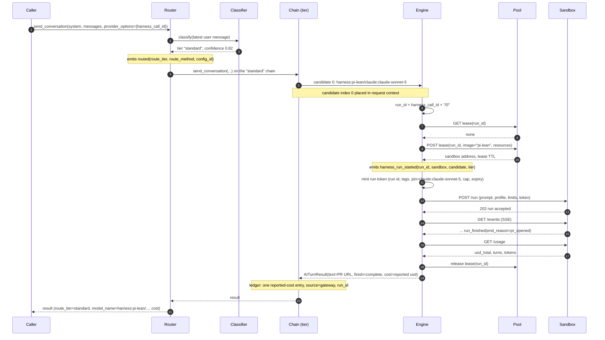
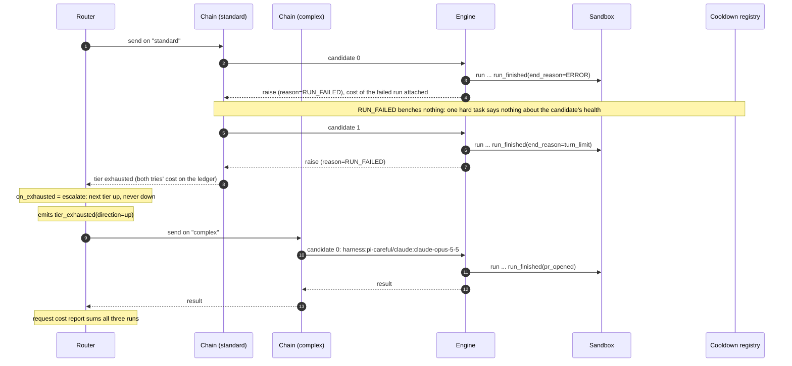
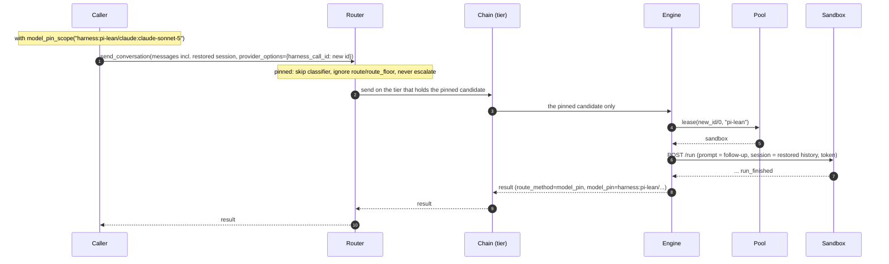
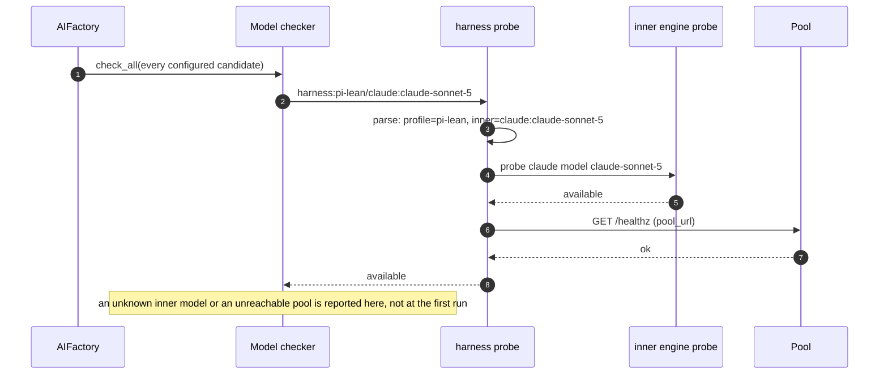

# Harness Engine Design

## Summary

This document describes a `harness` completions engine. It lets a router
tier candidate name a whole coding run instead of a single model call. The
candidate form is `harness:<profile>/<inner-engine>:<inner-model>`, for
example `harness:pi-lean/claude:claude-sonnet-5`.

The router, fallback chain, cooldowns, model pin, per-call floors, and the
request cost report treat a run the same way they treat any other
completions call. The engine itself holds no state between calls: it reads
its run identity from the call, asks two remote servers for what it needs,
blocks until the run ends, and returns a result with a cost report.

This engine exists to serve the meta-harness, a control plane that routes
coding tasks to a harness-and-model combination and runs the harness in a
sandbox. The meta-harness is the caller in every diagram below. Its own
design document carries the whole-system sequences (task API, scheduler,
gateway, console); this document stops at the library's boundary.

The library never knows what program runs inside the sandbox. The profile
name is an opaque string the engine passes along. The sandbox program (pi,
or anything else) is owned by the meta-harness and speaks a small Run API.

## What this library adds

| Change | Where |
|---|---|
| `harness` completions engine: registry entry, model-string parser, probe that delegates to the inner model's probe and checks `pool_url`, capability table that delegates to the inner model's, pool and Run API client | `completions/ai_harness_completions.py`, `ai_provider_registry.py`, `util/ai_model_probes.py` |
| `harness_run_started` observability event at lease time (run id, sandbox, candidate, tier) | the engine |
| Reported-cost entry in the request cost ledger, so an engine can record dollars a gateway stated rather than tokens times a price | `middleware/request_cost.py` |
| `AiFallbackReason.RUN_FAILED`, with no cooldown period | `ai_provider_exceptions.py`, `completions/ai_fallback_cooldown.py` |
| The fallback chain places the candidate index in the request-scoped observability context | `completions/ai_fallback_completions.py` |
| `providers.harness` with `pool_url` and `gateway_url`; credentials stay in the environment | `ai_models_config.py`, `schemas/` |

Later, optional: a cancel event on completions calls; a streaming form of
`send_conversation` with typed events.

## Parties in the diagrams

| Party | Owned by | Role |
|---|---|---|
| Caller | the calling system | In the meta-harness this is the dispatcher, run from a run workflow: it builds the client with `AIFactory`, renders the task spec as the latest user message, and passes `harness_call_id` in `provider_options`. The library does not care who calls it; any Python program with harness candidates in its `models.json` is a caller |
| Router | this library | `AiRouterCompletions`: classifies the prompt, picks a tier, runs the tier's chain |
| Chain | this library | `AiFallbackCompletions` for one tier: tries candidates in order, applies cooldowns, sums cost across tries |
| Engine | this library | `AiHarnessCompletions`: one blocking call per run |
| Pool | the calling system | Pool manager: leases sandboxes by run id |
| Sandbox | the calling system | The harness server inside a leased sandbox: `POST /run`, `GET /events`, `GET /usage`, cancel |
| Gateway | ai-api-unified-http | Where the sandbox program sends its model calls; outside these diagrams except where noted |

Run id is `harness_call_id` plus the candidate index, so a retried call
derives the same id and finds its run.

## Scenario 1: a routed run that succeeds



## Scenario 2: the first candidate has no sandbox; the second runs

```mermaid
sequenceDiagram
    autonumber
    participant F as Chain (tier)
    participant E as Engine
    participant P as Pool
    participant S as Sandbox
    participant CD as Cooldown registry

    F->>E: candidate 0: harness:pi-lean/claude:claude-sonnet-5
    E->>P: GET lease(call/0) -> none; POST lease(call/0, "pi-lean")
    P-->>E: 503 no capacity within ready_timeout
    E-->>F: raise AiProviderRequestError(reason=UNAVAILABLE)
    F->>CD: bench candidate 0 for 30 s (reason UNAVAILABLE)
    Note over F: UNAVAILABLE is in fallback_on: move on
    F->>E: candidate 1: harness:pi-careful/openai:gpt-5.6-luna
    E->>P: lease(call/1, "pi-careful")
    P-->>E: sandbox
    E->>S: POST /run ... GET /events ... run_finished
    E-->>F: result with reported cost
    Note over F: request total = cost of try 0 (zero) + try 1
    F-->>F: return result; provider_engine/model name the candidate that served
```

## Scenario 3: the run fails on the task; the tier is exhausted; escalate



## Scenario 4: a follow-up pinned to the original candidate



## Scenario 5: the caller's process dies mid-run and retries

```mermaid
sequenceDiagram
    autonumber
    participant C as Caller
    participant F as Chain (tier)
    participant E as Engine
    participant P as Pool
    participant S as Sandbox

    C->>F: call (harness_call_id = X)
    F->>E: candidate 0
    E->>P: lease(X/0) -> sandbox A
    E->>S: POST /run; GET /events ...
    Note over C,E: caller process exits; sandbox A keeps running
    C->>F: same call again (harness_call_id = X)
    F->>E: candidate 0
    E->>P: GET lease(X/0)
    P-->>E: existing lease: sandbox A, run in progress
    Note over E: re-attach, no second run, no second lease
    E->>S: GET /events (from cursor 0)
    S-->>E: replayed events ... run_finished
    E->>S: GET /usage
    E-->>F: result with the run's full reported cost
```

## Scenario 6: the lease TTL passes; the engine cancels and raises TIMEOUT

```mermaid
sequenceDiagram
    autonumber
    participant F as Chain (tier)
    participant E as Engine
    participant S as Sandbox
    participant P as Pool

    F->>E: candidate 0, request_timeout_seconds = lease TTL
    E->>S: POST /run; GET /events
    Note over E: deadline passes with no run_finished
    E->>S: POST /cancel
    S-->>E: run_canceled, partial usage
    E->>P: release lease
    E-->>F: raise (reason=TIMEOUT), partial cost attached
    Note over F: TIMEOUT in fallback_on -> next candidate; otherwise the call fails with the cost so far
```

## Scenario 7: startup check of a harness candidate



## What the engine does not do

- It never calls a model. The classifier call happens in the router before
  the engine is chosen; the sandbox program's model calls go to the gateway.
- It never streams progress through the router. Progress is read from the
  sandbox's event stream by the calling system.
- It never holds a run between calls. Everything it needs arrives with the
  call or is asked of the pool.
